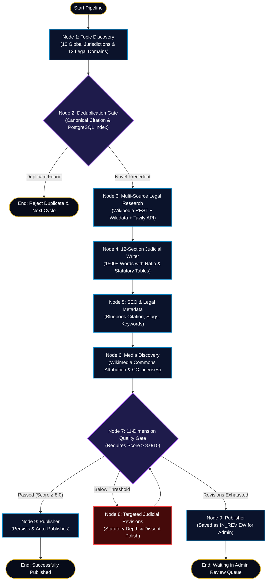

# Verdicts AI — Multi-Agent LangGraph Architecture

Verdicts AI is an autonomous, multi-agent AI system built to research, generate, quality-audit, and publish comprehensive, 12-section encyclopedic guides and breaking legal wire reporting for supreme court rulings worldwide.

---

## 1. LangGraph State Machine Architecture

---

## 2. 12-Section Encyclopedic Article Specification

Every judgment guide generated by `writer_node` contains:

1. **Case Overview, Judicial Posture & Historical Context**: Parties, court of record, procedural posture, societal stakes.
2. **Statutory, Constitutional & Treaty Framework**: Comparative table of applicable constitutional clauses, organic acts, and international covenants.
3. **Core Legal Questions & Certified Inquiries**: Certified questions presented to the judicial bench.
4. **Petitioner / Appellant Arguments**: Legal contentions, statutory interpretations, doctrines invoked.
5. **Respondent / Appellee Contentions**: Defense rebuttals, sovereign immunity, public interest justifications.
6. **Judicial Bench & Deliberation Dynamics**: Bench composition, Chief Justice, decision ratio (e.g. 9-0, 7-6, 5-4).
7. **The Majority Opinion & Ratio Decidendi**: The binding constitutional rule of law and standard of scrutiny affirmed.
8. **Concurring Opinions & Alternative Reasoning**: Distinct judicial rationale agreeing with the disposition.
9. **Dissenting Opinions & Counter-Theories**: Minority dissents, warnings against doctrinal instability.
10. **Precedential Impact & Judicial Doctrines Established**: Legal tests established (Proportionality, Basic Structure, Strict Scrutiny).
11. **Global Comparative Law & International Reception**: Reception by foreign supreme courts and international tribunals.
12. **Executive Summary, Official Citations & Quick FAQs**: Standard Bluebook/OSCOLA citations, counsel takeaways, and 3-4 structured FAQs.

---

## 3. Node Responsibility Breakdown

| Node Name | Module Reference | Primary Responsibility |
| :--- | :--- | :--- |
| **`discover_node`** | `app/graph/nodes.py` | Rotates through 10 global jurisdictions and 12 legal categories to find landmark cases and breaking news. |
| **`deduplicate_node`** | `app/graph/nodes.py` | Canonical key hashing and PostgreSQL index check to guarantee zero duplicate coverage. |
| **`research_node`** | `app/graph/nodes.py` | Synthesizes verifiable facts, statutory codes, and case outcomes via Wikipedia API and Tavily Search. |
| **`writer_node`** | `app/graph/nodes.py` | Generates authoritative, 1500+ word guides structured into 12 sections with markdown tables. |
| **`seo_node`** | `app/graph/nodes.py` | Generates URL-friendly slugs, high-CTR meta descriptions, and legal taxonomy tags. |
| **`image_node`** | `app/graph/nodes.py` | Queries Wikimedia Commons for freely licensed images with author and CC license attribution. |
| **`quality_node`** | `app/graph/nodes.py` | Evaluates the draft across 11 quality dimensions. Only drafts $\ge 8.0/10$ auto-publish. |
| **`revision_node`** | `app/graph/nodes.py` | Performs targeted corrective rewrites if an article scores below threshold before re-scoring. |
| **`publisher_node`** | `app/graph/nodes.py` | Persists article, logs evaluation breakdown, invalidates cache, and updates 200/day counter. |
